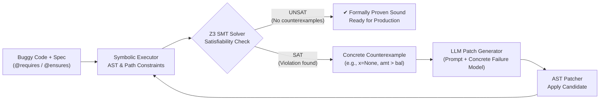
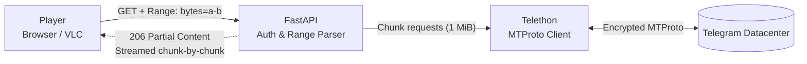
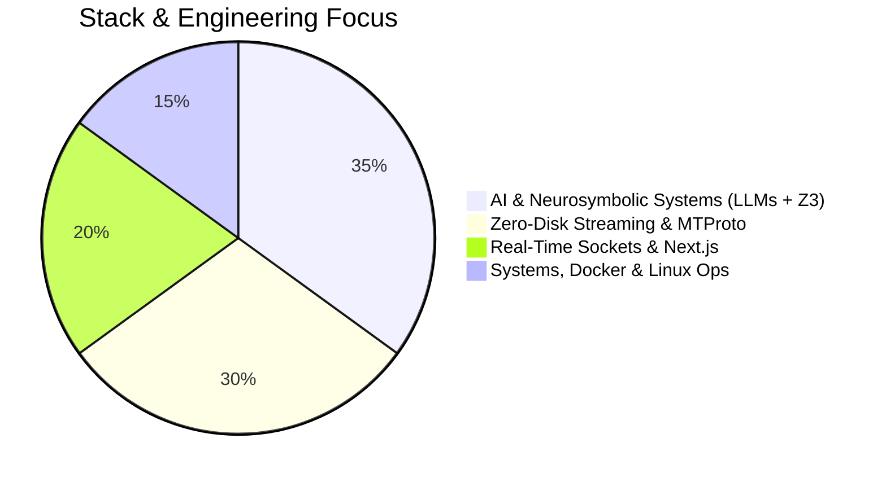

<!--
  Profile README for github.com/acedev0

  Setup
  - The repo must be named exactly "acedev0" (same as the username) and be public.
  - Needs ./assets/banner.svg in the same repo. The header is self-hosted, so it
    can't break when a third-party image service is down.
-->

 

&nbsp;

  

<a href="#featured-work">Featured work</a> &nbsp;·&nbsp;
<a href="#neurosymbolic-ai-loop">AI &amp; Verification</a> &nbsp;·&nbsp;
<a href="#how-the-streaming-stack-works">Streaming stack</a> &nbsp;·&nbsp;
<a href="#engineering-distribution">Focus</a> &nbsp;·&nbsp;
<a href="#how-i-build">Principles</a> &nbsp;·&nbsp;
<a href="#toolbox">Toolbox</a> &nbsp;·&nbsp;
<a href="#lets-talk">Contact</a>

 

## Hey, I'm Ace 👋

I build systems that bridge **Generative AI**, **Formal Verification**, and **High-Throughput Network Plumbing**.

My work focuses on the intersection of probabilistic models and deterministic guarantees:
- 🧠 **Neurosymbolic AI & LLMs:** Harnessing modern LLMs to synthesize code patches, coupled with **Z3 SMT solvers** that mathematically prove safety before a single line ships.
- ⚡ **Zero-Disk Media Streaming:** Custom byte-range proxies translating HTTP `Range` requests into real-time **MTProto chunks** without touching the server's disk.
- 🌐 **Real-Time Synchronized Web Apps:** Reactive multi-client sync architectures on **Next.js**, **WebSockets**, and **Prisma**.

I spend most of my time on what happens *off* the happy path: memory ceilings, token budgets, failure recovery, concurrency locks, and where the trust boundaries sit.

<table>
  <tr>
    <td width="33%" valign="top">
      <h4>🧠 Neurosymbolic AI</h4>
      <a href="https://github.com/acedev0/verifix"><b>VeriFix</b></a>: Binding <b>LLM generative synthesis</b> to <b>Z3 SMT formal verification</b> in a self-healing CEGIS loop.
    </td>
    <td width="33%" valign="top">
      <h4>⚡ Zero-Disk Streaming</h4>
      Tagged releases of <a href="https://github.com/acedev0/cinevault"><b>CineVault</b></a> and <a href="https://github.com/acedev0/televault"><b>TeleVault</b></a>: Streaming multi-gigabyte media with flat memory ceilings.
    </td>
    <td width="33%" valign="top">
      <h4>🌐 Real-Time Systems</h4>
      <b>Ace Hub</b> and <a href="https://github.com/acedev0/AceUnzipBot"><b>AceUnzipBot</b></a>: Lockstep watch-parties and FIFO MTProto workers.
    </td>
  </tr>
</table>

**Ask me about:**
`Generative AI & LLMs` · `Z3 SMT Formal Verification` · `CEGIS Loops` · `MTProto / Telethon` · `HTTP Range Requests` · `Async Python Concurrency` · `Docker in Production`

 

## Featured work

<table>
  <tr>
    <td width="50%" valign="top">
      <h3>🛡️ <a href="https://github.com/acedev0/verifix">VeriFix</a></h3>
      
<b>Neurosymbolic code repair: LLM generative patching meets Z3 formal verification.</b>

      
Combines LLMs with an SMT constraint solver in a CounterExample-Guided Inductive Synthesis (CEGIS) loop. Solvers mathematically prove patches or generate concrete counterexample models to trigger LLM self-correction.

      
<code>Python</code> <code>LLMs</code> <code>Z3 Solver</code> <code>Formal Verification</code> <code>AST</code>

      

        
        
      

    </td>
    <td width="50%" valign="top">
      <h3>🎬 <a href="https://github.com/acedev0/cinevault">CineVault</a></h3>
      
<b>Netflix-style discovery and streaming, powered by Telegram.</b>

      
Search for a title, press play, and the bytes flow from Telegram directly to the browser or VLC player via HTTP range requests. No persistent media storage on the server.

      
<code>Python</code> <code>FastAPI</code> <code>Telethon</code> <code>MTProto</code> <code>Docker</code>

      

        
        
      

    </td>
  </tr>
  <tr>
    <td width="50%" valign="top">
      <h3>📺 <a href="https://github.com/acedev0/televault">TeleVault</a></h3>
      
<b>A private media library with a custom browser player.</b>

      
Playback runs on zero-disk byte-range streaming, thumbnails are WebP, and access is locked down with security-focused controls, including Argon2id hashing.

      
<code>Python</code> <code>FastAPI</code> <code>Telethon</code> <code>Argon2id</code> <code>Docker</code>

      

        
        
      

    </td>
    <td width="50%" valign="top">
      <h3>📦 <a href="https://github.com/acedev0/AceUnzipBot">AceUnzipBot</a></h3>
      
<b>Bulk archive extraction inside Telegram.</b>

      
Powered by 7-Zip. Jobs run through an asynchronous FIFO queue with live progress bars and thumbnails, plus a dedicated CLI and VPS deployment tooling.

      
<code>Python</code> <code>Telethon</code> <code>7-Zip</code> <code>AsyncIO</code> <code>Linux</code>

      

        
        
      

    </td>
  </tr>
  <tr>
    <td colspan="2" valign="top">
      <h3>🍿 Ace Hub</h3>
      
<b>Video discovery and synchronized watch parties.</b>

      
Real-time playback sync keeps every viewer in lockstep, on a responsive modern interface backed by a Prisma-managed database and WebSockets.

      
<code>Next.js 15</code> <code>React 19</code> <code>Prisma</code> <code>Socket.IO</code> <code>WebSockets</code>

      

        
        
      

    </td>
  </tr>
</table>

 

## Architecture & Systems

### Neurosymbolic AI Loop

> [!NOTE]
> **Probabilistic generation needs deterministic verification.** LLMs generate intuitive patches; the Z3 SMT solver either mathematically proves the contract or extracts the exact failing edge-case input.

 

### Zero-Disk Streaming Stack

> [!NOTE]
> **The server is a pipe, not a warehouse.** Bytes move from Telegram to the client player as they are requested, and nothing is retained on disk.

- **Range-first:** Each `Range: bytes=a-b` request maps directly to the minimal set of MTProto chunk fetches.
- **Flat memory:** Chunks stream into the HTTP response buffer on the fly. Memory use stays constant regardless of whether the file is 50 MB or 10 GB.
- **Immediate cancellation:** When the viewer scrubs or disconnects, the in-flight MTProto stream is aborted immediately.

 

## Engineering Distribution

 

## How I build

| Principle | In practice |
| :-- | :-- |
| **Prove, don't guess** | LLMs propose candidate solutions; formal SMT solvers mathematically verify correctness before deployment. |
| **Stream, don't store** | Data flows from source to client. Nothing sits on the server waiting to be pruned. |
| **Bound everything** | Memory, concurrency, LLM token limits, and queue depths all have explicit hard ceilings. |
| **Automate the repetitive** | If I do it twice by hand, it becomes a script, a background queue, or a service. |
| **Design for failure** | Retries, cancellation, and recovery are fundamental architectural pillars, not post-incident patches. |
| **Keep trust boundaries explicit** | Cryptographic hashing (Argon2id), auth tokens, and permissions live at strictly drawn edges. |

 

## Toolbox

<table>
  <tr>
    <td><b>AI &amp; Verification</b></td>
    <td>
      
      
      
      
      
      
    </td>
  </tr>
  <tr>
    <td><b>Languages</b></td>
    <td>
      
      
      
      
      
    </td>
  </tr>
  <tr>
    <td><b>Backend</b></td>
    <td>
      
      
      
      
    </td>
  </tr>
  <tr>
    <td><b>Frontend</b></td>
    <td>
      
      
      
    </td>
  </tr>
  <tr>
    <td><b>Real-Time</b></td>
    <td>
      
      
      
      
    </td>
  </tr>
  <tr>
    <td><b>Data &amp; Security</b></td>
    <td>
      
      
      
      
      
    </td>
  </tr>
  <tr>
    <td><b>Ops &amp; Infra</b></td>
    <td>
      
      
      
      
      
    </td>
  </tr>
</table>

 

## What I can help with

- **AI & Neurosymbolic Engineering:** LLM agent tool calling, structured generation, CEGIS self-repair, SMT formal contract proofs.
- **Telegram Automation & MTProto:** Telethon userbots, bot transactions, high-volume queue workers, MTProto chunk streaming.
- **Zero-Disk Streaming Engines:** Range-request media proxies that stream directly from cloud networks with flat memory.
- **Real-Time Collaborative Apps:** Synchronized state, WebSockets, Next.js frontend architectures.
- **Production Hardening:** Dockerizing complex Python/Node runtimes, systemd daemon management, secure reverse proxies.

 

## Let's talk

Got an ambitious challenge involving **LLMs & AI**, **formal verification**, **streaming infrastructure**, or **real-time systems**? Message me on [Telegram](https://t.me/Aceddev) or [send an email](mailto:Acedevmc@gmail.com).

 

**Stream, don't store. Prove, don't guess.**

Built by Ace, <a href="https://github.com/acedev0">@acedev0</a>

