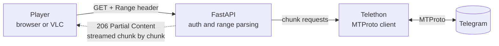

<!--
  Profile README for github.com/acedev0
  - The repo must be named exactly "acedev0" (same as the username) and be public.
  - Needs ./assets/banner.svg in the same repo. The header is self-hosted, so it
    can't break when a third-party image service is down.
-->

 

&nbsp;

## Hey, I'm Ace

I'm an independent developer who builds the plumbing behind Telegram-native products: **MTProto automation**, **media streaming that never touches the disk**, and the **real-time web apps** that sit on top of them.

I spend most of my time on what happens *off* the happy path: memory ceilings, concurrency limits, failure recovery, and where the trust boundaries sit.

<table>
  <tr>
    <td width="33%" valign="top">
      <b>Building</b> 
      <a href="https://github.com/acedev0/ace-hub">Ace Hub</a>, a watch-party platform with synchronized playback on Next.js, Socket.IO and Prisma.
    </td>
    <td width="33%" valign="top">
      <b>Shipping</b> 
      Tagged releases of CineVault, TeleVault and AceUnzipBot.
    </td>
    <td width="33%" valign="top">
      <b>Exploring</b> 
      Queues, retries and observability for long-running jobs, and leaner byte-range streaming.
    </td>
  </tr>
</table>

**Ask me about:** Telethon and MTProto, HTTP range requests, async Python concurrency, and running services safely with Docker and systemd.

## Featured work

<!-- Private repo? Shields can't read it, so delete that card's release / last-commit badges. -->
<table>
  <tr>
    <td width="50%" valign="top">
      <h3>🎬 <a href="https://github.com/acedev0/cinevault">CineVault</a></h3>
      
Netflix-inspired movie discovery and streaming built on Telegram. Search for a title, press play, and the bytes flow from Telegram to the player over HTTP range requests, with no persistent media storage on the server.

      
<code>Python</code> <code>FastAPI</code> <code>Telethon</code> <code>Docker</code>

      

        
        
      

    </td>
    <td width="50%" valign="top">
      <h3>📦 <a href="https://github.com/acedev0/AceUnzipBot">AceUnzipBot</a></h3>
      
Archive extraction for Telegram, powered by 7-Zip. Bulk jobs run through a FIFO queue with live progress and thumbnails, plus a dedicated CLI and deployment tooling.

      
<code>Python</code> <code>Telethon</code> <code>7-Zip</code> <code>Linux</code>

      

        
        
      

    </td>
  </tr>
  <tr>
    <td width="50%" valign="top">
      <h3>📺 <a href="https://github.com/acedev0/televault">TeleVault</a></h3>
      
A private Telegram media library with a custom browser player. Playback runs on byte-range streaming, thumbnails are WebP, and access is protected with security-focused controls, including Argon2id hashing.

      
<code>Python</code> <code>FastAPI</code> <code>Telethon</code> <code>Docker</code>

      

        
        
      

    </td>
    <td width="50%" valign="top">
      <h3>🍿 <a href="https://github.com/acedev0/ace-hub">Ace Hub</a></h3>
      
Video discovery and synchronized watch parties. Real-time playback sync keeps multiple viewers in lockstep, on a responsive interface backed by a Prisma-managed database.

      
<code>Next.js</code> <code>React</code> <code>Prisma</code> <code>Socket.IO</code>

      

        
        
      

    </td>
  </tr>
</table>

## How the streaming stack works

CineVault and TeleVault share one idea: **the server is a pipe, not a warehouse.**

<!-- Check these three bullets against what the code really does before publishing. -->
- **Range-first.** Each `Range: bytes=a-b` request is mapped to the smallest set of MTProto chunk fetches that covers it, so seeking and scrubbing stay cheap.
- **Flat memory.** Chunks are handed to the HTTP response as the client consumes them. Nothing is buffered to disk, and memory use doesn't grow with file size.
- **Stop when the viewer stops.** When a player seeks away or disconnects, the in-flight download is cancelled instead of burning bandwidth.

**Rules I build by:** stream, don't store. Bound memory and concurrency. Automate the repetitive. Design for failure. Keep trust boundaries explicit.

## Toolbox

<table>
  <tr>
    <td><b>Languages</b></td>
    <td>
      
      
      
      
    </td>
  </tr>
  <tr>
    <td><b>Backend</b></td>
    <td>
      
      
      
    </td>
  </tr>
  <tr>
    <td><b>Frontend</b></td>
    <td>
      
      
      
      
    </td>
  </tr>
  <tr>
    <td><b>Data</b></td>
    <td>
      
      
      
      
    </td>
  </tr>
  <tr>
    <td><b>Ops</b></td>
    <td>
      
      
      
      
      
    </td>
  </tr>
</table>

## Let's talk

Got something involving Telegram automation, streaming infrastructure, or a real-time web app? Message me on [Telegram](https://t.me/Aceddev) or [send an email](mailto:Acedevmc@gmail.com). I'm happy to talk it through.

 

**Stream, don't store.**

Built by Ace, <a href="https://github.com/acedev0">@acedev0</a>

