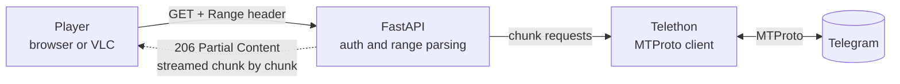
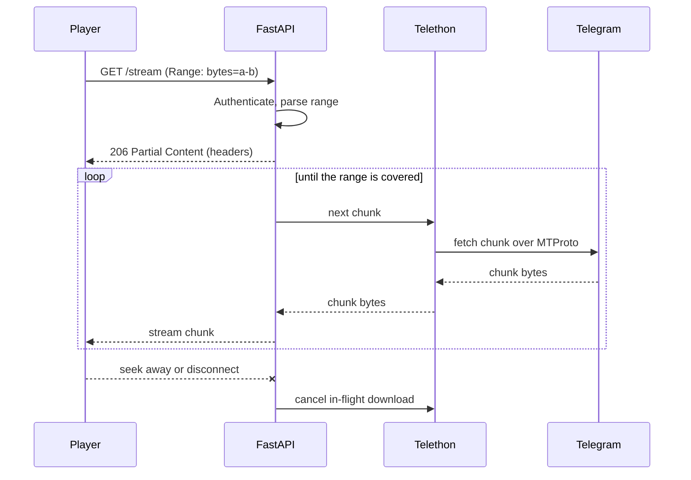

<!--
  Profile README for github.com/acedev0

  Setup
  - The repo must be named exactly "acedev0" (same as the username) and be public.
  - Needs ./assets/banner.svg in the same repo. The header is self-hosted, so it
    can't break when a third-party image service is down.

  Before publishing
  - Check the three streaming bullets and the code sketch against what the code really does.
  - Private repo? Shields can't read it, so delete that card's release / last-commit badges.
-->

<div align="center">



<br />

<a href="https://t.me/Aceddev"></a>
&nbsp;
<a href="mailto:Acedevmc@gmail.com"></a>

<br /><br />

<sub>
<a href="#featured-work">Featured work</a> &nbsp;·&nbsp;
<a href="#how-the-streaming-stack-works">Streaming stack</a> &nbsp;·&nbsp;
<a href="#how-i-build">Principles</a> &nbsp;·&nbsp;
<a href="#toolbox">Toolbox</a> &nbsp;·&nbsp;
<a href="#lets-talk">Contact</a>
</sub>

</div>

<br />

## Hey, I'm Ace 👋

I'm an independent developer who builds the plumbing behind Telegram-native products: **MTProto automation**, **media streaming that never touches the disk**, and the **real-time web apps** that sit on top of them.

I spend most of my time on what happens *off* the happy path: memory ceilings, concurrency limits, failure recovery, and where the trust boundaries sit. Anyone can make a demo work once. I like making things keep working.

<table>
  <tr>
    <td width="33%" valign="top">
      <h4>🔨 Building</h4>
      <a href="https://github.com/acedev0/ace-hub"><b>Ace Hub</b></a>, a watch-party platform with synchronized playback on Next.js, Socket.IO and Prisma.
    </td>
    <td width="33%" valign="top">
      <h4>🚀 Shipping</h4>
      Tagged releases of <b>CineVault</b>, <b>TeleVault</b> and <b>AceUnzipBot</b>.
    </td>
    <td width="33%" valign="top">
      <h4>🔭 Exploring</h4>
      Queues, retries and observability for long-running jobs, and leaner byte-range streaming.
    </td>
  </tr>
</table>

**Ask me about:**
`Telethon` · `MTProto` · `HTTP range requests` · `async Python concurrency` · `Docker + systemd in production`

<br />

## Featured work

<table>
  <tr>
    <td width="50%" valign="top">
      <h3>🎬 <a href="https://github.com/acedev0/cinevault">CineVault</a></h3>
      <p><b>Netflix-style discovery and streaming, powered by Telegram.</b></p>
      <p>Search for a title, press play, and the bytes flow from Telegram to the player over HTTP range requests. No persistent media storage on the server.</p>
      <p><code>Python</code> <code>FastAPI</code> <code>Telethon</code> <code>Docker</code></p>
      <p>
        <a href="https://github.com/acedev0/cinevault/releases"></a>
        
      </p>
    </td>
    <td width="50%" valign="top">
      <h3>📦 <a href="https://github.com/acedev0/AceUnzipBot">AceUnzipBot</a></h3>
      <p><b>Bulk archive extraction inside Telegram.</b></p>
      <p>Powered by 7-Zip. Jobs run through a FIFO queue with live progress and thumbnails, plus a dedicated CLI and deployment tooling.</p>
      <p><code>Python</code> <code>Telethon</code> <code>7-Zip</code> <code>Linux</code></p>
      <p>
        <a href="https://github.com/acedev0/AceUnzipBot/releases"></a>
        
      </p>
    </td>
  </tr>
  <tr>
    <td width="50%" valign="top">
      <h3>📺 <a href="https://github.com/acedev0/televault">TeleVault</a></h3>
      <p><b>A private media library with a custom browser player.</b></p>
      <p>Playback runs on byte-range streaming, thumbnails are WebP, and access is locked down with security-focused controls, including Argon2id hashing.</p>
      <p><code>Python</code> <code>FastAPI</code> <code>Telethon</code> <code>Docker</code></p>
      <p>
        <a href="https://github.com/acedev0/televault/releases"></a>
        
      </p>
    </td>
    <td width="50%" valign="top">
      <h3>🍿 <a href="https://github.com/acedev0/ace-hub">Ace Hub</a></h3>
      <p><b>Video discovery and synchronized watch parties.</b></p>
      <p>Real-time playback sync keeps every viewer in lockstep, on a responsive interface backed by a Prisma-managed database.</p>
      <p><code>Next.js</code> <code>React</code> <code>Prisma</code> <code>Socket.IO</code></p>
      <p>
        
        
      </p>
    </td>
  </tr>
</table>

<br />

## How the streaming stack works

CineVault and TeleVault share one idea:

> [!NOTE]
> **The server is a pipe, not a warehouse.** Bytes move from Telegram to the player as they are requested, and nothing is kept.



- **Range-first.** Each `Range: bytes=a-b` request is mapped to the smallest set of MTProto chunk fetches that covers it, so seeking and scrubbing stay cheap.
- **Flat memory.** Chunks are handed to the HTTP response as the client consumes them. Nothing is buffered to disk, and memory use doesn't grow with file size.
- **Stop when the viewer stops.** When a player seeks away or disconnects, the in-flight download is cancelled instead of burning bandwidth.

<details>
<summary><b>See the request lifecycle and the core idea in code</b></summary>

<br />

**One seek, end to end**



**Mapping a byte range to aligned chunks** (a sketch of the idea, not the production code)

```python
CHUNK = 1024 * 1024  # 1 MiB, MTProto's per-request ceiling


def chunk_plan(start: int, end: int):
    """Yield (offset, drop_head, drop_tail) for an inclusive byte range."""
    first, last = start // CHUNK, end // CHUNK
    for i in range(first, last + 1):
        offset = i * CHUNK
        drop_head = max(start - offset, 0)             # trim the front of the first chunk
        drop_tail = max(offset + CHUNK - 1 - end, 0)   # trim the back of the last chunk
        yield offset, drop_head, drop_tail
```

Fetch aligned chunks, trim the edges, stream the result. The player never knows the difference.

</details>

<br />

## How I build

| Principle | In practice |
| :-- | :-- |
| **Stream, don't store** | Data flows from source to client. Nothing sits on the server waiting to be cleaned up. |
| **Bound everything** | Memory, concurrency and queue depth all have explicit ceilings. |
| **Automate the repetitive** | If I do it twice by hand, it becomes a script, a queue or a service. |
| **Design for failure** | Retries, cancellation and recovery are part of the first design, not a patch. |
| **Keep trust boundaries explicit** | Auth, hashing and permissions live at clearly drawn edges. |

<br />

## Toolbox

<table>
  <tr>
    <td><b>Languages</b></td>
    <td>
      
      
      
      
      
    </td>
  </tr>
  <tr>
    <td><b>Backend</b></td>
    <td>
      
      
      
    </td>
  </tr>
  <tr>
    <td><b>Frontend</b></td>
    <td>
      
      
      
    </td>
  </tr>
  <tr>
    <td><b>Real-time</b></td>
    <td>
      
      
      
      
    </td>
  </tr>
  <tr>
    <td><b>Data</b></td>
    <td>
      
      
      
      
    </td>
  </tr>
  <tr>
    <td><b>Ops</b></td>
    <td>
      
      
      
      
      
    </td>
  </tr>
</table>

<br />

## What I can help with

- **Telegram automation:** MTProto clients, bots, bulk-job queues, progress reporting.
- **Streaming backends:** range-request services that stay flat on memory and disk.
- **Real-time web apps:** synchronized state, WebSockets, and a clean Next.js front end.
- **Production hardening:** containers, systemd services, reverse proxies, sane failure behavior.

## Let's talk

Got something involving Telegram automation, streaming infrastructure, or a real-time web app? Message me on [Telegram](https://t.me/Aceddev) or [send an email](mailto:Acedevmc@gmail.com). I'm happy to talk it through.

<div align="center">

<br />

**Stream, don't store.**

<sub>Built by Ace, <a href="https://github.com/acedev0">@acedev0</a></sub>

</div>
